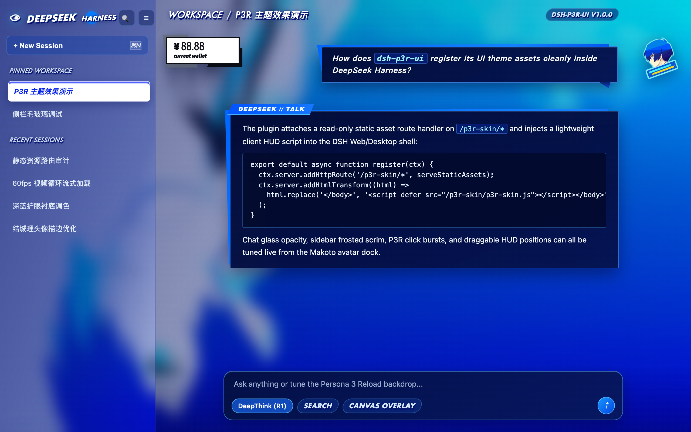
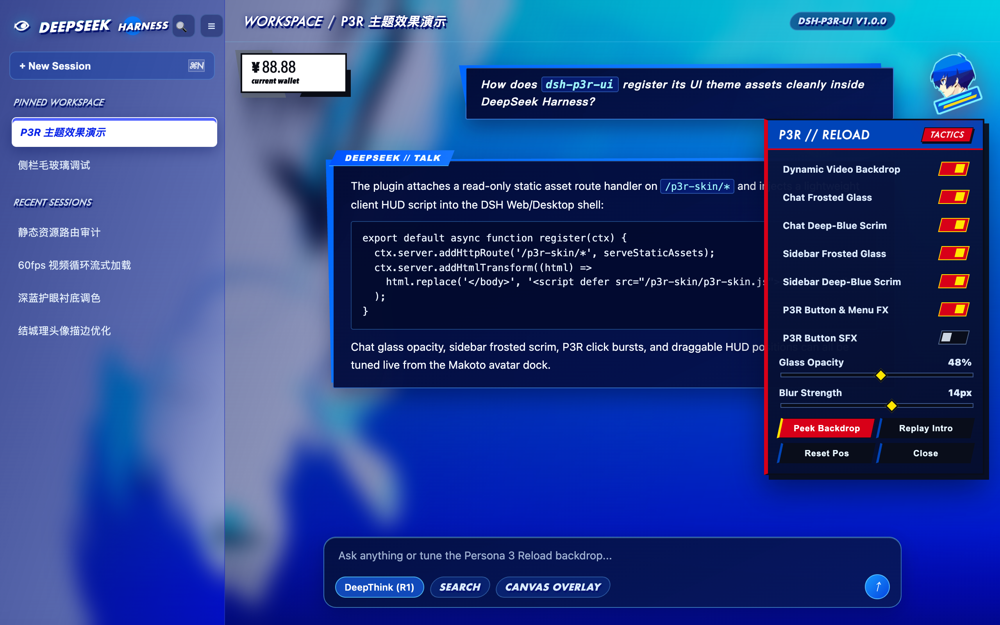
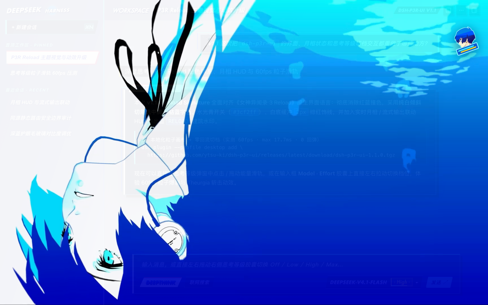

# dsh-p3r-ui

简体中文 | [English](#english)

面向 **DeepSeek Harness (DSH)** 桌面端与 Web 端的 **Persona 3 Reload（结城理）** 动态主题皮肤插件 —— 提供 60fps 水下循环视频背景、独立可调毛玻璃面板、P3R 风格字体与点击动效、可拖拽结城理头像控制坞，以及可拖拽的 `current wallet` 余额悬浮卡。

## 界面预览

> 说明：以下演示图基于脱敏模拟工作区与测试余额（`¥88.88`）截取，不含任何个人真实会话或账户信息。

| 主界面效果（毛玻璃对话 + 结城理头像 HUD + 余额悬浮卡） |
| :---: |
|  |

| 控制面板展开（`P3R // RELOAD` 实时参数调节） | 全景预览模式（隐藏 UI 欣赏动态水下背景） |
| :---: | :---: |
|  |  |

---

## 功能特性

- **60fps 动态视频背景 + 可选落水转场**：通过同源 `/p3r-skin/loop.mp4`（默认 `assets/menu-loop-fv2-60fps-h264.mp4`，回退 `assets/menu-loop-h264.mp4`）在底层画布流畅播放循环背景；若在插件的 `assets/` 目录下放入可选开场视频（`menu-clean-4k60-h264.mp4` / `menu-clean-h264.mp4`，不随包分发），将在每次宿主启动后首次打开时自动播放一次落水入场并无缝衔接循环。
- **自适应毛玻璃与护眼衬底**：会话主区与左侧边栏支持独立开关、深蓝护眼衬底以及实时透明度（`0%–92%`）与模糊度（`0px–24px`）调节，确保设置弹窗、代码块、对话框和会话标题清晰可读。
- **结城理透明头像交互坞（`#p3r-dsh-pill`）**：采用无背景 PNG 立绘与 `#7beeff` 轮廓光效 + 经典倾斜 HP/SP 条；点击展开 `P3R // RELOAD` 设置菜单，长按拖拽可自由移动屏幕位置并本地记忆。
- **独立余额悬浮组件（`#p3r-dsh-wallet`）**：以 `current wallet` P3R 卡片样式实时展示账户余额；支持点击刷新、长按拖拽移动位置。
- **P3R 点击动效与可选合成音效**：提供棱角光片点击爆裂特效及 Web Audio API 合成的 P3R 按键音效（音效默认关闭，可在面板中手动开启）。
- **UI 语言自动跟随 DeepSeek Harness**：通过只读客户端模块桥接 `ctx.locale`（`@deepseek-ai/dsh-client-locale`）及宿主页面语言标识，设置面板、按钮与悬浮提示自动同步 DSH 当前界面语言（支持简体中文 / English / 日本語，无需重载实时切换）。
- **零外部联网依赖**：不加载任何远程字体、CDN 资源或统计脚本，所有视觉效果均在本机运行。

---

## 兼容性与安装方式

- **兼容要求**：DSH `0.2.0-rc.1` – `0.2.x`（`engines.dsh: ">=0.2.0-rc.1 <0.3.0-0"`），Node.js `>= 20`。

### 1. 官方 DSH Desktop 桌面端
在 DeepSeek Harness 桌面端打开 **设置 → 插件**，通过内置插件管理器或 `dshmarket` 插件市场安装，或手动导入 GitHub Release 发布的 `.tgz` 安装包。

> **桌面端与 `dsh web` profile 区别提示**：在终端执行 `dsh plugin --profile web add ...` 会安装到 `profiles/web`，**不会**作用于桌面端应用使用的 `profiles/desktop`。桌面端请直接在应用内插件管理器安装，或在命令行显式指定 `--profile desktop`。

### 2. DSH Web / 命令行安装

通过 npm / 社区目录安装（发布后）：
```sh
dsh plugin --profile web add dsh-p3r-ui
```

或直接安装 GitHub Release 预构建包（内置已构建的 `dist/p3r-skin.js`，免额外构建步骤）：
```sh
dsh plugin --profile <your-profile> add https://github.com/ytsu-ki/dsh-p3r-ui/releases/latest/download/dsh-p3r-ui-1.0.0.tgz
```

安装完成后，请重启 DSH（macOS 桌面端使用 `Cmd + Q` 完全退出后重新打开，或重启 `dsh web`）以加载新增静态路由与注入脚本。

---

## 权限界定与安全说明

`dsh-p3r-ui` 严格定位为**纯前端视觉皮肤层插件**，遵循**最小权限、仅本机运行、只读最小字段**原则。完整审计细节请见 [SECURITY.md](SECURITY.md)。

### 本插件使用的能力边界

| 涉及能力 / 接口 | 用途 | 严格范围与安全限制 |
|---|---|---|
| `webServer`（`ctx.inject(['webServer'])`、`webserver/index-inject`、`tapIndex`） | 向 DSH 页面注入 `dist/p3r-skin.js` 并挂载 `/p3r-skin/*` 本地资源路由。 | 仅注入视觉皮肤脚本（`id: 'p3r-dsh-skin-inline'`）；构建与加载前都会校验脚本非空且不含 `</script` 标签逃逸。 |
| 本地 HTTP 路由（`/p3r-skin/makoto-avatar.png`、`loop.mp4`、`intro.mp4`、`boot-state`、`wallet.json`） | 提供头像 PNG、背景视频流（支持 `Range`）、进程内一次性开场状态与只读余额 JSON。 | 所有接口首行执行 `rejectIfUntrusted(req, res, ctx)`：拒绝 `sec-fetch-site` 不是 `same-origin`/`none` 的浏览器请求（`cross-site` 与 `same-site` 均返回 `403`）、优先调用宿主 `connection.requestRejection(req)` 校验连接可信度，回退检查时仅允许环回主机（`localhost` / `127.0.0.1` / `::1`）。静态资源路径在启动时从固定相对位置解析，不拼接 URL 查询参数，不存在路径穿越风险。 |
| `ctx.get('deepseekAccount')` *（可选）* | 为可拖拽 `current wallet` 挂件显示当前余额。 | 仅调用只读 `acct.getBalance(...)`（8 秒超时，12 秒内存缓存），仅向页面返回 `{ ok, source, currency, normalBalance, bonusBalance, totalBalance, updatedAt }` 数值汇总；**不读取也不透传** Token、Cookie、密钥或账单明细，不触发任何充值或扣费操作。 |
| `./client` 语言桥接（`client/locale-bridge.js`，注入 `@deepseek-ai/dsh-client-locale`） | 让设置卡片与悬浮提示词实时跟随 DSH 当前界面语言。 | 仅只读读取 `ctx.locale.getSnapshot().active` 与订阅变更事件，不写入或修改 DSH 语言偏好配置。 |
| `$DSH_HOME/.dshw-usage.json` *（可选只读兜底）* | 当宿主未挂载 `deepseekAccount`（如独立 Web 调试）时读取数值余额。 | 仅以只读方式读取 `$DSH_HOME/.dshw-usage.json` 或 `$DSH_HOME/profiles/desktop/.dshw-usage.json` 中的有限数字字段 `lastBalance` 与 `todayUsage`，忽略其他字段。 |
| 浏览器 `localStorage` & `sessionStorage` | 保存皮肤开关、透明度/模糊度滑块、组件拖拽坐标与当前会话开场状态。 | 使用键名：`p3r_dsh_desktop_skin_v2`（兼容读取 `v1`）、`p3r_dsh_widget_pos_v1`、`p3r_dsh_boot_id`、`p3r_dsh_intro_seen`。 |

### 本插件明确**不会**做的事情

- **不注册 Agent 工具 / 不修改提示词**：不注册任何 LLM 工具、Slash 指令或子代理，不注入或篡改系统 Prompt。
- **不读取对话与工作区内容**：不访问 `~/.dsh/sessions` 聊天记录、附件或用户工作区代码文件。
- **不接触凭据文件**：不读取 `.credentials.yaml` 或任何登录态秘密文件。
- **不写宿主机磁盘 / 不执行系统命令**：零 `writeFile` 写盘操作，零 `node:child_process` 引入；不修改 `cordis.patch.yml` 或任何 DSH 配置文件，不触发命令行或宿主重启。
- **零外部联网请求**：宿主侧与浏览器侧均不向第三方服务器发送任何请求，仅访问同源 `/p3r-skin/*` 路由。

---

## 面板控制说明

点击右上角 **结城理头像图标** 可展开 / 收起 `P3R // RELOAD` 设置卡片：

- **启用动态视频背景**：总开关；关闭后立即恢复 DSH 原生外观，无需重启。
- **会话区毛玻璃** / **主区深蓝护眼衬底**：控制中间对话区的透明毛玻璃与深蓝可读性衬底。
- **左侧菜单毛玻璃** / **侧栏深蓝护眼衬底**：控制左侧导航栏的透明毛玻璃与深蓝衬底。
- **P3R 按键/菜单动效** / **P3R 按键音效**：控制点击棱角光爆动效与 Web Audio 合成音效。
- **毛玻璃透明度**（`0%`–`92%`）与 **模糊强度**（`0px`–`24px`）：实时拖动调整。
- **全景预览**：临时淡出界面层以预览完整背景画面。
- **重播落水**：重播落水入场过渡（若有开场视频）或重置背景播放进度。
- **重置位置**：将头像按钮与余额悬浮卡恢复到默认屏幕坐标。

---

## 本地开发与构建

本插件零第三方运行时依赖（`index.js` 仅使用 Node.js 内置模块，`src/skin-runtime.js` 为独立原生 JS）：

```sh
npm run build   # 从 src/skin-runtime.js 构建 dist/p3r-skin.js
npm run check   # 对 index.js、src/skin-runtime.js、dist/p3r-skin.js 执行 node --check
```

请勿直接手动编辑 `dist/p3r-skin.js`，改动请写在 [src/skin-runtime.js](src/skin-runtime.js) 后运行 `npm run build`。

---

## 开源协议与素材声明

- **插件代码**：遵循 [MIT 协议](LICENSE)（`Copyright (c) 2026 ytsu-ki`）。
- **美术与视频素材（`assets/`）**：《女神异闻录 3 Reload》相关角色立绘与主题视频素材**不在 MIT 授权范围内**，仅作为个人非商业界面美化素材随插件原样分发。详见 [PROVENANCE.md](PROVENANCE.md)。

---

<a id="english"></a>

# dsh-p3r-ui (English)

[简体中文](#dsh-p3r-ui) | English

A **Persona 3 Reload (Makoto Yuki)** visual UI skin plugin for **DeepSeek Harness (DSH)** Desktop & Web UI — featuring a 60fps looping underwater video backdrop, adaptive frosted-glass panels, P3R-inspired typography & click FX, a draggable Makoto portrait settings dock, and a draggable `current wallet` balance HUD widget.

## Screenshots

> Note: Captured in a sanitized demo workspace with mock balance (`¥88.88`); no personal sessions or account data are included.

| Main Workspace (Frosted Glass + Makoto HUD + Wallet Widget) |
| :---: |
|  |

| Control Dock Expanded (`P3R // RELOAD`) | Full-Bleed Backdrop Peek Mode |
| :---: | :---: |
|  |  |

## Features

- **60fps Video Backdrop + Optional Splash Intro**: Renders `/p3r-skin/loop.mp4` (`assets/menu-loop-fv2-60fps-h264.mp4` with fallback to `assets/menu-loop-h264.mp4`) into a hardware-decoded canvas backdrop behind the DSH UI. If an optional intro clip (`menu-clean-4k60-h264.mp4` / `menu-clean-h264.mp4`, not shipped) is placed in the plugin's `assets/` directory, it plays once per host startup and seamlessly transitions into the loop.
- **Adaptive Frosted Glass**: Independent toggles and sliders (`0%–92%` opacity, `0–24px` blur) for the chat session area and the left sidebar, plus dark-blue contrast scrims so conversation text, settings dialogs, and modals remain clearly readable.
- **Interactive P3R Portrait Dock (`#p3r-dsh-pill`)**: Transparent Makoto Yuki portrait cutout with `#7beeff` rim glow and tilted HP/SP bar. Click to toggle the settings panel (`P3R // RELOAD`), or hold and drag to reposition anywhere on screen (position saved locally).
- **Floating Wallet HUD (`#p3r-dsh-wallet`)**: Displays current account balance in `current wallet` P3R card styling; click to refresh, hold and drag to reposition.
- **P3R Click FX & Optional Web Audio SFX**: Angular blue/crimson click bursts and synthesized P3R UI tones (audio is **off by default**).
- **Automatic DSH Language Sync**: Reads DSH's active UI locale via the read-only `./client` bridge (`@deepseek-ai/dsh-client-locale`) and host chrome fallback, updating all dock switches, buttons, and tooltips live (Simplified Chinese / English / Japanese).
- **Zero External Network Dependencies**: No remote fonts, CDNs, or analytics calls — all visual effects run locally on the DSH host.

## Compatibility & Installation

- **Tested DSH Version**: `0.2.0-rc.1` – `0.2.x` (`engines.dsh: ">=0.2.0-rc.1 <0.3.0-0"`, Node.js `>= 20`).

### 1. Official DSH Desktop App
Open **Settings → Plugins** (`设置 → 插件`) in DeepSeek Harness Desktop and install via the Plugin Manager / Plugin Market (`dshmarket`), or import the Release `.tgz` tarball.

> **Desktop vs `dsh web` Profiles**: Running `dsh plugin --profile web add ...` installs into `profiles/web`, **not** the `profiles/desktop` profile used by the DSH Desktop app. Install inside the Desktop Plugin Manager (or target `--profile desktop`).

### 2. DSH Web (`dsh web` / CLI)

From npm / community catalog (once published):
```sh
dsh plugin --profile web add dsh-p3r-ui
```

Or directly from the GitHub Release tarball (pre-built `dist/p3r-skin.js`, no build step required):
```sh
dsh plugin --profile <your-profile> add https://github.com/ytsu-ki/dsh-p3r-ui/releases/latest/download/dsh-p3r-ui-1.0.0.tgz
```

Restart DSH (`Cmd + Q` and reopen on macOS Desktop, or restart `dsh web`) to activate the routes and runtime script.

## Permissions & Security Boundaries

`dsh-p3r-ui` is designed strictly as a **UI skin layer** following **least-privilege, local-only, read-only** principles. Full technical details are documented in [SECURITY.md](SECURITY.md).

- **Host capabilities used**:
  - `webServer` (`ctx.inject(['webServer'])`, `webserver/index-inject`, `tapIndex`) to inject `dist/p3r-skin.js` and mount local `/p3r-skin/*` routes protected by `rejectIfUntrusted(req, res, ctx)` (`sec-fetch-site: cross-site` rejected with `403`, `connection.requestRejection(req)` enforced when available, strict loopback host fallback, fixed startup asset candidates).
  - Optional `ctx.get('deepseekAccount')` read-only `getBalance(...)` (8s timeout, 12s RAM cache) and optional read-only fallback `$DSH_HOME/.dshw-usage.json` (`lastBalance` / `todayUsage` numbers only) for the wallet HUD.
  - Read-only `./client` locale bridge (`client/locale-bridge.js`, `@deepseek-ai/dsh-client-locale`) to follow DSH's active UI language without modifying host settings.
  - Browser `localStorage` / `sessionStorage` keys strictly for skin preferences, widget coordinates, and per-tab splash state.
- **Explicitly never done**: No agent tools, no prompt/session/workspace reading, no credential/token access, zero disk writes (`writeFile`), zero `child_process` spawning, and zero outbound network requests.

## Development & Build

```sh
npm run build   # Builds dist/p3r-skin.js from src/skin-runtime.js
npm run check   # Runs node --check on index.js, src/skin-runtime.js, dist/p3r-skin.js
```

## License & Asset Provenance

- **Source Code**: [MIT License](LICENSE) (`Copyright (c) 2026 ytsu-ki`).
- **Media Assets (`assets/`)**: Persona 3 Reload visual assets are **excluded from the MIT License** and provided as-is strictly for personal UI theming. See [PROVENANCE.md](PROVENANCE.md).
